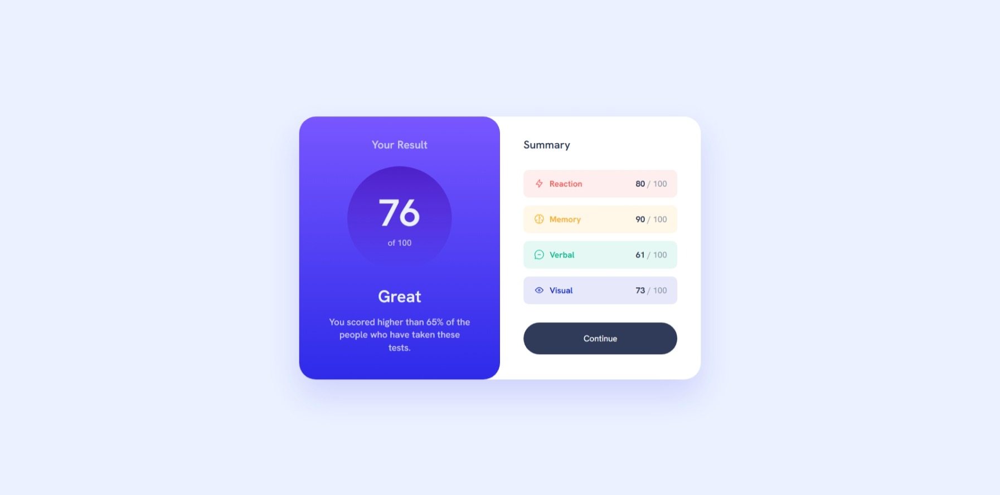
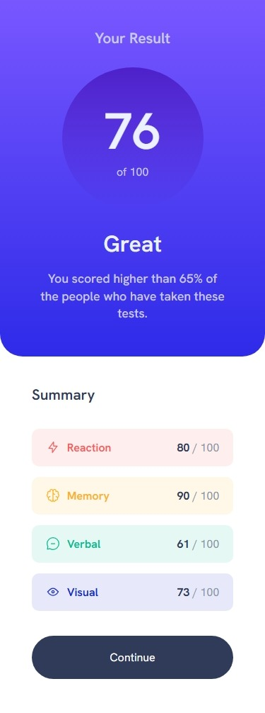
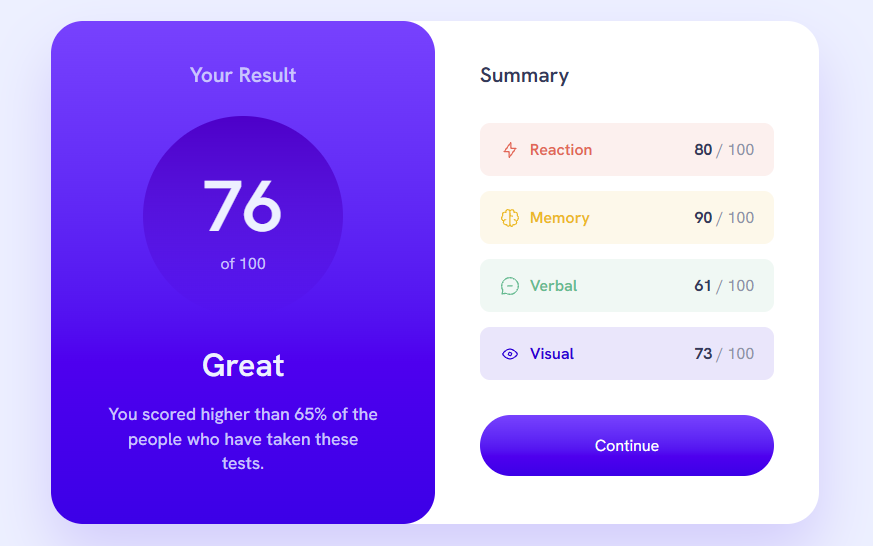

# Frontend Mentor - Results Summary Component solution

This is a solution to the [Results Summary Component challenge on Frontend Mentor](https://www.frontendmentor.io/challenges/results-summary-component-CE_K6s0maV). Frontend Mentor challenges help you improve your coding skills by building realistic projects. 

## Table of contents

- [Overview](#overview)
  - [Screenshot](#screenshot)
  - [Links](#links)
- [My process](#my-process)
  - [Built with](#built-with)
  - [What I learned](#what-i-learned)
  - [Continued development](#continued-development)
  - [Useful resources](#useful-resources)
- [Author](#author)
- [Acknowledgments](#acknowledgments)

## Overview

### Screenshot

### Desktop

### Mobile

### Active

### Links

- Live Site URL: [Here](https://lrsnvanta.github.io/frontend-mentor-projects/results-summary-component/)

## My process

### Built with

- Semantic HTML5 markup
- CSS custom properties
- Flexbox
- Media query
- Pseudo elements & classes

### What I learned

Use the DevTools and inspect the CSS Box model. It will be easier if you're looking at which element or content is causing the problem.

Also, I learned about semantic HTML. It's important to know about if your tags are semantically correct rather than just using divs.

### Continued development

- Figma
- CSS Layouts
- Flexbox
- Grid
- Semantic HTML

### Useful resources

- [Semantic HTML](https://developer.mozilla.org/en-US/docs/Glossary/Semantics#semantics_in_html) - You can learn Semantic HTML here.

- [Box Model](https://developer.mozilla.org/en-US/docs/Learn_web_development/Core/Styling_basics/Box_model) - You can learn about the box model of the web page.

- [Flexbox](https://developer.mozilla.org/en-US/docs/Learn_web_development/Core/CSS_layout/Flexbox) - You can learn about Flexbox here.

- [Units](https://developer.mozilla.org/en-US/docs/Learn_web_development/Core/Styling_basics/Values_and_units) - Values & Units

## Author

- Frontend Mentor - [@lrsnvanta](https://www.frontendmentor.io/profile/lrsnvanta)

## Acknowledgments

Google everything if you have any questions in your mind. ChatGPT or Grok or any other LLMs are useful too.
